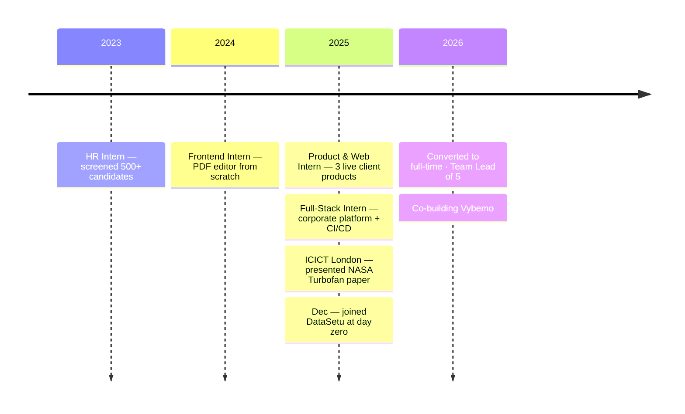

<!-- Profile README for github.com/krishmodi0202 — goes in the krishmodi0202/krishmodi0202 repo -->


<div align="center">


<br/>

<a href="https://www.linkedin.com/in/krishmodi33"></a>&nbsp;
<a href="mailto:krishmodi33@gmail.com"></a>&nbsp;
<a href="https://github.com/krishmodi0202"></a>

<br/>

<a href="https://datasetu.co.in"></a>
<a href="https://vybemo.com"></a>


</div>

---

<table>
<tr>
<td width="55%" valign="top">

### 👨‍💻 About me

```ts
const krish = {
  role:      "SDE & Team Lead",
  leading:   "5 engineers · PRD → production",
  building:  ["DataSetu", "Vybemo"],
  loves:     ["systems that scale", "LLMs that behave",
              "features users actually need"],
  research:  "4 Springer papers · ICICT London '25",
  degree:    "B.Tech CE · PDEU · 8.75 CGPA",
  motto:     "Ship it, measure it, make it better.",
};
```

</td>
<td width="45%" valign="top">

### ⚡ Right now

- 🧭 Leading the **DataSetu** team
- 🤖 Building an **LLM assistant** with tool calling, guardrails & evals
- 🔌 Running an **MCP server** with 80+ tools for AI agents
- 👗 Scaling **Vybemo** on Redis + AWS
- ✍️ Writing about what I learn

</td>
</tr>
</table>

## 🚀 Things I've shipped

<table>
<tr>
<td width="50%" valign="top">

### 🤝 DataSetu
  

AI-powered B2B networking & CRM. App, web, admin and associate portals on a **1,000+ endpoint** Node.js backend.
**Semantic search over 200K+ records, 65% faster** · RAG WhatsApp assistant · 5 payment gateways.

`React Native` `Node.js` `FastAPI` `MongoDB` `RabbitMQ` `Meilisearch` `OpenAI`

</td>
<td width="50%" valign="top">

### 👗 Vybemo
 

Social fashion app — outfit posts, timed rating rounds, city battles.
**340+ APIs** built to scale horizontally: Redis distributed locks, Socket.IO Redis adapter, zero-downtime deploys.

`Node.js` `Redis` `Socket.IO` `AWS` `React Native` `Next.js`

</td>
</tr>
<tr>
<td width="50%" valign="top">

### 📣 White-label WhatsApp Platform
Broadcast campaigns + team inbox on the official WhatsApp Cloud API. **One codebase → a branded product per client.**

`TypeScript` `Monorepo` `Docker` `WhatsApp Cloud API`

</td>
<td width="50%" valign="top">

### 🎯 AI Lead-Sourcing Engine
Finds leads daily, drafts outreach with AI, and **sends only after a human confirms**.

`Python` `LLMs` `Node.js` `React`

</td>
</tr>
<tr>
<td width="50%" valign="top">

### 🧠 AI Sprint Planner *(hackathon)*
Turns a PRD into epics, user stories and sprint timelines with AI, then exports to Trello.

`React` `Express` `Supabase` `OpenAI`

</td>
<td width="50%" valign="top">

### 🏗️ 10+ client platforms
E-commerce, travel, insurance renewals, export documents, events and community orgs — as **builder or team lead**, with CI/CD and tests.

`MERN` `Next.js` `GitHub Actions` `Jest`

</td>
</tr>
</table>

## 🛣️ Journey



## 🔬 Research

| | Paper | Idea |
|:-:|---|---|
| ⚡ | **Hybrid AI Optimization for Transformer Power Systems** | 3 cooperating DQN agents + an autoencoder that flags faults |
| ✈️ | **Predictive Maintenance — NASA Turbofan** | Remaining-useful-life prediction · *ICICT London 2025* |
| 🩺 | **Diabetes Prediction** | Statistical feature engineering + ML |
| 🧾 | **Hyper-localized Tax Optimization** | AI/ML for region-level tax planning |

## 🧰 Toolbox

<div align="center">

**Backend & infra**<br/>


**Frontend & mobile**<br/>


**AI / ML** — LLMs · RAG · Embeddings · MCP · Prompt engineering · LLM evals · TensorFlow · scikit-learn · Pandas<br/>
**Product** — PRDs · Roadmapping · Sprint planning · KPIs · UAT · Stakeholder management

</div>

<div align="center">

<sub>💡 Most of my work lives in private company repos — the contribution graph below includes it.</sub>

</div>


